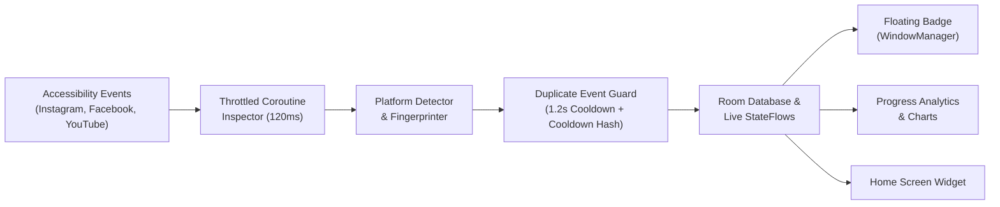
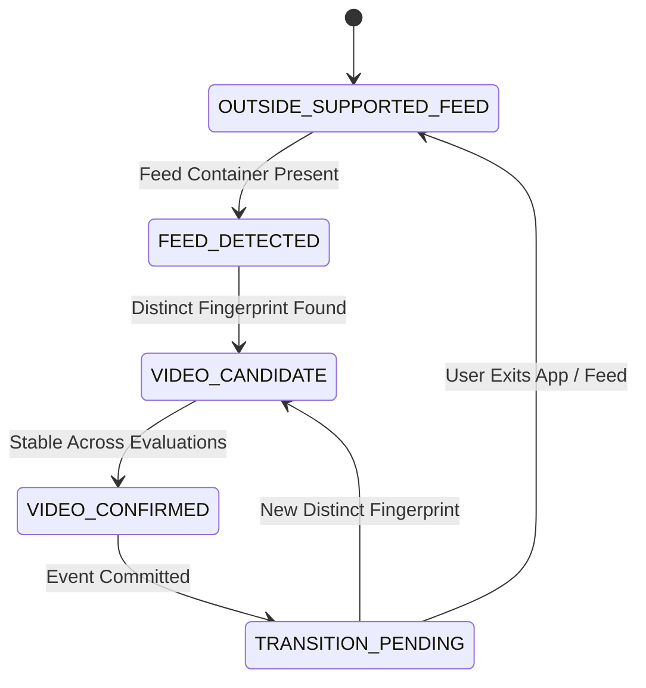
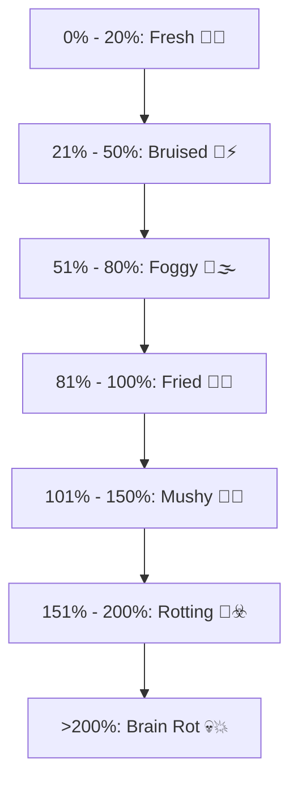

# ReelCount — Master Project & Technical Handbook

> **Application Identifier:** `com.jabir.brot`  
> **Lead Developer:** SM Ali Ahsan Al Jabir  
> **GitHub Profile:** [https://github.com/cyberlog101238](https://github.com/cyberlog101238)  
> **Facebook:** [https://www.facebook.com/sm.ali.ahsan.al.jabir](https://www.facebook.com/sm.ali.ahsan.al.jabir)  
> **Target SDK:** Android 14 (API 34) | **Min SDK:** Android 8.0 (API 26)  
> **Architecture:** Clean Architecture + MVVM + Local-First Reactive Streams  

---

## 1. Executive Summary & Philosophy

### Core Mission
Short-form vertical video feeds (Instagram Reels, Facebook Reels, YouTube Shorts) are engineered around variable ratio reinforcement schedules. Because users experience zero friction during swipe gestures, short-form consumption induces "algorithmic dissociation" (commonly known as *brain rot*), where users lose awareness of elapsed time and total volume consumed.

**ReelCount** restores user agency through ambient, real-time feedback:
1. **Frictionless Real-Time Feedback:** A clean, movable floating counter badge appears *only* while watching reels, displaying only the exact count.
2. **Zero Persistent Status-Bar Clutter:** Managed via direct system `WindowManager` without persistent foreground notifications.
3. **100% Privacy & Zero Network Overhead:** Completely offline (no `INTERNET` permission). All analytics, fingerprints, and timestamps remain in a local SQLite/Room database.
4. **Cognitive Wellbeing Metrics:** Beyond raw counts, ReelCount tracks viewing velocity (reels/hr), dwell time, and a dynamic 7-tier Brain Mascot state.



---

## 2. Reverse Engineering & Platform Detection Heuristics

Because social media platforms do not expose public video IDs or canonical shortcodes to accessibility trees, ReelCount extracts an invariant SHA-256 fingerprint from structural node metadata:

$$\text{Fingerprint Hash} = \text{SHA-256}\big(\text{Platform} + \text{Creator} + \text{Caption[:80]} + \text{Audio} + \text{CompositeSig}\big)$$

### A. Instagram Reels (`com.instagram.android`)
* **Dedicated Viewer Activity:** Detects `InstagramMainActivity` containing full-screen video containers.
* **View ID Signatures:** Inspects `clips_viewer`, `clips_video_container`, `clips_media_item`, `reel_viewer_root`.
* **Action Column:** Verifies the right-side vertical button stack (Like, Comment, Share, Remix).
* **Fingerprint Extraction:**
  * Regex search on content descriptions: `"Reel by (.*)"` or `"Profile picture of (.*)"`.
  * Filters out UI action verbs and extracts the primary caption.

### B. Facebook Reels (`com.facebook.katana`)
* **Activity & View ID Signatures:** Detects `FbShortsViewerActivity`, `FbShorts`, and `FbMainTabActivity` when reels components are active.
* **Meta Litho Framework Handling:** Meta strips conventional view IDs in favor of Litho virtual component trees. ReelCount navigates up to 120 nodes deep to capture Litho text and content descriptions.
* **Metric Stripping Regex:** To prevent like/view numbers from corrupting fingerprints, numbers matching metric counts (`^[\d.,\s]+[KkMmBbTt]?$`) are stripped.
* **Exact Word Matching:** Checks `text.equals(word, ignoreCase = true)` rather than substring containment, preserving captions that mention words like "like" or "share".
* **Composite Signature Fallback:** If creator and caption are sparse, hashes top visible non-metric tokens so every reel is uniquely identified.

### C. YouTube Shorts (`com.google.android.youtube`)
* **Fragment Signatures:** Identifies `reel_watch_fragment_root`, `reel_recycler`, `reel_player`.
* **Carousel Rejection:** Excludes horizontal home-feed carousels by requiring full-screen container geometry ($\ge 75\%$ screen height) and vertical right action column presence.
* **Fingerprint Extraction:** Extracts channel handle from `@username` content descriptions and Shorts title tags.

---

## 3. Deduplication State Machine & Guard

To ensure a video is counted **exactly once** per viewing occurrence, ReelCount utilizes a 6-state finite state machine backed by `DuplicateEventGuard`:



### Protection Layers in `DuplicateEventGuard`:
1. **Fling Cooldown (1200ms):** A human cannot digest a short-form video in under 1.2 seconds. Rapid flings are suppressed.
2. **Active Video Pointer:** Repeated accessibility ticks (playback time, comment changes, reaction heart animations) are suppressed.
3. **Recent Re-Entry Cooldown (6 Seconds):** Returning to the same video within 6 seconds is treated as the same occurrence.
4. **Session-Level Deduplication:** Every viewed fingerprint hash is registered in the active session's hash table.

---

## 4. Floating Live Overlay Architecture

Unlike conventional Android overlay apps that require persistent status-bar notifications, ReelCount uses a **Direct WindowManager Controller**:

* **Lifecycle Binding:** [`FloatingOverlayController`](file:///C:/Users/aliah/.gemini/antigravity/scratch/ReelCount/app/src/main/java/com/jabir/brot/service/FloatingOverlayController.kt) is owned directly by [`ReelCountAccessibilityService`](file:///C:/Users/aliah/.gemini/antigravity/scratch/ReelCount/app/src/main/java/com/jabir/brot/service/ReelCountAccessibilityService.kt).
* **Zero Foreground Notification:** Because `AccessibilityService` is bound by Android's `system_server`, it does not require a foreground service or persistent notification.
* **Minimalist Design:** Displays **only** a clean circular badge containing today's total reel count.
* **Exit Debouncing (1200ms):** When leaving a reel or loading the next video, hiding is debounced by 1.2s to prevent screen flickering.
* **Touch & Drag Physics:** Clamped to physical screen boundaries with persistent coordinate memory (`savedX`, `savedY`). Tapping the badge displays a brief toast with today's count and target.
* **Over-Target Indicator:** The badge ring smoothly transitions from warm amber (`#F59E0B`) to rose red (`#F43F5E`) when the daily target is reached.

---

## 5. Cognitive Digital Wellbeing & Analytics

### A. Velocity & Dwell Time
* **Velocity ($\text{Reels/Hour}$):** Calculated as:
  $$\text{Velocity} = \frac{\text{Total Reels Today}}{\max(\text{Active Dwell Hours}, 0.05)}$$
  Capped to realistic bounds to filter out fast gesture flings.
* **Average Dwell Time:** Active duration in feeds divided by total reels watched.

### B. Progress Visualization (Daily & Weekly)
* **Daily Breakdown:** 24 hourly segment bars showing consumption distribution across morning, afternoon, evening, and night.
* **Weekly Breakdown:** 7 daily segment bars comparing today against the previous 6 days with an average baseline indicator.

### C. The 7-Tier Brain State Lifecycle


---

## 6. Security, Privacy & Google Play Protect

### Zero Network Footprint
* ReelCount declares **NO `android.permission.INTERNET`**.
* The app is physically incapable of transmitting network packets.

### Scoped Accessibility Config
[`accessibility_service_config.xml`](file:///C:/Users/aliah/.gemini/antigravity/scratch/ReelCount/app/src/main/res/xml/accessibility_service_config.xml) explicitly defines:
```xml
android:packageNames="com.instagram.android,com.facebook.katana,com.google.android.youtube"
```
The Android OS prevents the service from receiving events from any other application (including banking, payment, SMS, or browser apps).

### Play Protect Appeal Context
When APKs declaring `AccessibilityService` are transferred via messaging apps (e.g. WhatsApp), Google Play Protect's automated "Enhanced Fraud Protection" flags them. An appeal has been registered for `com.jabir.brot`. Users can install via their phone's native **Files / Downloads** app or temporarily toggle off Play Protect scanning during initial sideloading.

---

## 7. Complete Codebase Sitemap

```
app/src/main/java/com/jabir/brot/
│
├── data/                                 # Data Layer
│   ├── ReelCountDatabase.kt              # Room Database (v1)
│   ├── dao/
│   │   ├── ViewingEventDao.kt            # CRUD & deduplication queries
│   │   ├── DailyAggregateDao.kt          # Precomputed daily summary records
│   │   └── TrackingSessionDao.kt         # Session start/end metrics
│   ├── entity/
│   │   ├── ViewingEventEntity.kt         # Raw event record
│   │   ├── DailyAggregateEntity.kt       # Aggregated day record
│   │   └── TrackingSessionEntity.kt      # Session duration record
│   └── repository/
│       ├── CountingRepository.kt         # Repository interface
│       ├── CountingRepositoryImpl.kt     # Room repository implementation
│       └── UserPreferencesRepository.kt  # Jetpack DataStore preferences
│
├── domain/                               # Domain Layer
│   ├── DailyStatisticsCalculator.kt      # Velocity & dwell time calculations
│   ├── GoalAlertManager.kt               # Target threshold alarm manager
│   ├── SessionManager.kt                 # Active session state management
│   ├── TrackingCoordinator.kt            # Master coordinator connecting service & DB
│   ├── TrackingDiagnostics.kt            # Real-time event log buffer
│   ├── detector/
│   │   ├── PlatformDetector.kt           # Detector contract
│   │   ├── VideoTransitionDetector.kt    # Multi-platform router
│   │   ├── InstagramReelsDetector.kt     # Instagram heuristics
│   │   ├── FacebookReelsDetector.kt      # Facebook Litho heuristics
│   │   └── YouTubeShortsDetector.kt      # YouTube Shorts heuristics
│   ├── guard/
│   │   └── DuplicateEventGuard.kt        # Cooldown & session deduplication
│   └── model/
│       ├── Platform.kt                   # INSTAGRAM, FACEBOOK, YOUTUBE
│       ├── DetectionEvent.kt             # Verified transition event
│       ├── DetectionState.kt             # 6-state FSM enum
│       ├── ScreenSnapshot.kt             # Abstracted screen representation
│       ├── VideoFingerprint.kt           # SHA-256 compound fingerprint
│       ├── TrackingStatus.kt             # Active / Idle / Paused states
│       └── ConfidenceLevel.kt            # Heuristic certainty score
│
├── service/                              # Service Layer
│   ├── ReelCountAccessibilityService.kt  # System-bound UI inspector
│   ├── FloatingOverlayController.kt      # Direct WindowManager floating badge
│   ├── FloatingCounterService.kt         # Neutralized legacy stub
│   ├── DailyNotificationScheduler.kt     # Daily 9 PM recap scheduler
│   ├── DailyRecapReceiver.kt             # BroadcastReceiver for recap notification
│   └── BootReceiver.kt                   # Restores alarms on device boot
│
└── ui/                                   # UI Layer (Jetpack Compose)
    ├── MainActivity.kt                   # Host ComponentActivity
    ├── components/
    │   ├── BrainMascotView.kt            # Animated pulsing mascot bubble
    │   ├── PlatformCard.kt               # Per-platform tally card
    │   └── StatusIndicator.kt            # Live connection pill
    ├── navigation/
    │   ├── NavGraph.kt                   # 5-tab navigation host
    │   └── Screen.kt                     # Route definitions
    ├── screens/
    │   ├── DashboardScreen.kt            # Home screen with hero count & cards
    │   ├── StatisticsScreen.kt           # Daily & Weekly progress bar charts
    │   ├── GoalsScreen.kt                # Target sliders & overlay switch
    │   ├── SettingsScreen.kt             # Theme, recap time & dev toggle
    │   ├── DeveloperScreen.kt            # Live diagnostic event inspector
    │   └── DiagnosticsScreen.kt          # System telemetry & permissions
    ├── theme/
    │   ├── Color.kt                      # Obsidian & Warm Amber palette
    │   └── Theme.kt                      # Material 3 dynamic color scheme
    ├── viewmodel/
    │   ├── DashboardViewModel.kt
    │   ├── StatisticsViewModel.kt
    │   ├── GoalsViewModel.kt
    │   ├── SettingsViewModel.kt
    │   └── DiagnosticsViewModel.kt
    └── widget/
        └── ReelCountAppWidgetProvider.kt # Android Home Screen Widget
```
