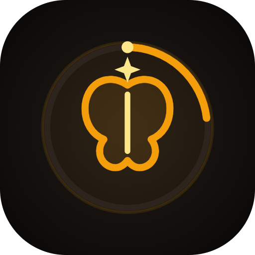

# ReelCount — Local-First Short Video Tracker & Digital Wellbeing

<p align="center">
  
  <br />
  <b>Break the doomscroll. Protect your brain from digital rot.</b>
</p>

<p align="center">
  <a href="https://github.com/cyberlog101238"></a>
  
  
  
  
  <a href="LICENSE"></a>
</p>

---

## 👨‍💻 Developer & Contact
* **Lead Developer:** SM Ali Ahsan Al Jabir
* **GitHub Profile:** [https://github.com/cyberlog101238](https://github.com/cyberlog101238)
* **Facebook:** [https://www.facebook.com/sm.ali.ahsan.al.jabir](https://www.facebook.com/sm.ali.ahsan.al.jabir)
* **Application ID:** `com.jabir.brot`

---

## 🛡️ Note on Google Play Protect (Statement & Appeal)

> [!IMPORTANT]
> **Developer Statement Regarding Play Protect Warning:**
> When sideloading ReelCount (especially if downloaded or shared via chat apps like WhatsApp), Google Play Protect may display a prompt stating:  
> *"App blocked to protect your device — This app can request access to sensitive data. This can increase the risk of identity theft or financial fraud."*
>
> **Why this happens:**
> * To automatically count short-form videos on Instagram, Facebook, and YouTube, ReelCount must declare an Android `AccessibilityService`.
> * Google Play Protect has an automated **"Enhanced Fraud Protection"** rule for internet-sideloaded APKs. Because malicious banking trojans frequently abuse accessibility permissions, Google automatically flags any sideloaded app requesting accessibility services as a potential risk.
>
> **Privacy Guarantee:**
> * **100% Offline (Zero Network Permissions):** ReelCount has **NO `INTERNET` permission**. It cannot send, receive, or upload any data outside your device.
> * **Zero Personal Data Collection:** The app never inspects passwords, private chats, or banking apps. The accessibility service is strictly scoped to Instagram, Facebook, and YouTube.
>
> **Official Appeal Submitted:**
> An official appeal has been submitted to Google via the [Google Play Protect Developer Appeal Form](https://support.google.com/googleplay/android-developer/contact/protectappeals) requesting formal whitelisting of the package `com.jabir.brot`.
>
> **How to install while the appeal is pending:**
> 1. **Option A (Recommended):** Open your phone's built-in **Files / File Manager** app (e.g. *Files by Google*, *My Files*, or *Xiaomi File Manager*), navigate to **Downloads**, and tap `ReelCount.apk` directly (installing from local storage instead of inside WhatsApp allows standard installation).
> 2. **Option B:** Open **Google Play Store** $\rightarrow$ tap Profile avatar $\rightarrow$ **Play Protect** $\rightarrow$ tap ⚙️ (Settings) $\rightarrow$ temporarily turn off **"Scan apps with Play Protect"** $\rightarrow$ install the app $\rightarrow$ turn Play Protect back on.

---

## 🌟 Key Features

* 🚀 **Universal Feed Detection:** Seamlessly monitors short-form videos across **Instagram Reels**, **Facebook Reels**, and **YouTube Shorts**.
* 🎯 **Smart Deduplication Guard:** Distinguishes genuine video transitions from playback scrub loops, likes, and comments. Enforces a 1.2-second human digestion cooldown and a 6-second re-entry window.
* 🫧 **Movable Floating Live Badge:**
  * Shows **only** the clean, round reel count badge.
  * Smooth, bounded drag-and-drop repositioning with persistent coordinate memory.
  * Hysteresis-backed debounced exit (1200ms) to prevent annoying flashing between videos.
  * **ZERO Persistent Status-Bar Notifications:** Uses direct `WindowManager` integration bound to the accessibility lifecycle.
* 📊 **Cognitive Digital Wellbeing & Analytics:**
  * **Real-time Velocity:** Measures Reels per hour and average dwell time per video.
  * **Interactive Progress Tab:** Visualizes hourly segments across the day and daily segments across the week.
  * **Dynamic Brain State:** From *Fresh* 🧠✨ to *Brain Rot* 💀💥 as daily consumption limits are reached.
* 🎨 **Obsidian & Warm Amber Theme:** Pure dark AMOLED theme with warm amber accents (`#F59E0B`). Fully reactive to dark/light switching.
* 📱 **Home Screen Widget:** Glances today's reel count, active dwell time, and current brain state right on your home screen.
* 🛠️ **Dedicated Developer Tab:** Toggleable diagnostic panel showing real-time event logs, node signatures, and state machine transitions for open-source contributors.
* 🔒 **100% Privacy & Zero Permissions Abuse:**
  * **NO INTERNET Permission:** The app is completely offline.
  * **NO Account Required:** All statistics are stored locally in Room SQLite.
  * **NO Text/Password Sniffing:** Only checks structural container IDs and video layout bounds.

---

## 🏗️ Architecture

ReelCount follows **Clean Architecture + MVVM** principles:

```
app/src/main/java/com/jabir/brot/
├── data/                    # Room Database, DAO entities, DataStore Preferences
│   ├── dao/                 # ViewingEventDao, DailyAggregateDao, TrackingSessionDao
│   ├── entity/              # Event logs and daily aggregates
│   └── repository/          # Offline repositories
├── domain/                  # Pure Kotlin domain logic & state machines
│   ├── detector/            # Platform-specific heuristics
│   │   ├── InstagramReelsDetector.kt
│   │   ├── FacebookReelsDetector.kt
│   │   ├── YouTubeShortsDetector.kt
│   │   └── PlatformDetector.kt
│   ├── guard/               # DuplicateEventGuard (debounce, session deduplication)
│   ├── model/               # DetectionEvent, ScreenSnapshot, VideoFingerprint
│   └── TrackingCoordinator.kt
├── service/                 # System service integrations
│   ├── ReelCountAccessibilityService.kt   # System-bound UI inspector
│   ├── FloatingOverlayController.kt       # Direct WindowManager floating badge
│   ├── DailyNotificationScheduler.kt      # Scheduled summary receiver
│   └── BootReceiver.kt                    # Restores schedules on restart
└── ui/                      # Jetpack Compose UI
    ├── components/          # Reusable cards, mascot views, indicators
    ├── navigation/          # NavGraph and tab definitions
    ├── screens/             # Dashboard, Statistics, Goals, Settings, Developer
    ├── theme/               # Color palette and typography
    ├── viewmodel/           # Screen ViewModels
    └── widget/              # Home screen Glance/AppWidgetProvider
```

---

## 📋 Target Platform Detection Heuristics

| Platform | Package | Primary Detection Signals | Deduplication Strategy |
| :--- | :--- | :--- | :--- |
| **Instagram Reels** | `com.instagram.android` | `clips_viewer`, `clips_video_container`, `clips_media_item`, "Reel by...", full-screen bounds ($\ge 75\%$). | SHA-256 fingerprint from `@author` and caption; settled swipe state machine. |
| **Facebook Reels** | `com.facebook.katana` | `FbShortsViewerActivity`, `FbShorts`, Litho virtual nodes ("Reel by...", "Like reel", "Original audio"), right action stack. | Regex metric stripping (`^[\d.,\s]+[KkMmBbTt]?$`), composite text signature fallback. |
| **YouTube Shorts** | `com.google.android.youtube` | `reel_watch_fragment_root`, `reel_recycler`, `reel_player`, Shorts pivot tab, channel handle. | Distinguishes full-screen Shorts fragment from 16:9 standard player and feed carousels. |

---

## 🛠️ Build & Installation Instructions

### Prerequisites
* **JDK 17+**
* **Android SDK 34 (Android 14)**

### Building the Debug APK
```bash
# On Windows (PowerShell)
.\gradlew.bat assembleDebug

# On macOS / Linux
chmod +x gradlew
./gradlew assembleDebug
```

The APK will be generated at:
```
app/build/outputs/apk/debug/app-debug.apk
```

---

## 📲 Setup on Android Device

1. **Install APK:**
   * Download the latest `ReelCount.apk` from the [Releases](https://github.com/cyberlog101238/ReelCount/releases) page.
   * Open via your device's native **Files / Downloads** app and tap install.
2. **Enable Accessibility:**
   * Go to **Settings** $\rightarrow$ **Accessibility** $\rightarrow$ **Downloaded Apps** $\rightarrow$ **ReelCount** $\rightarrow$ Turn **ON**.
   * *If Android 13/14 blocks with "Restricted Setting":* Go to **Settings** $\rightarrow$ **Apps** $\rightarrow$ **ReelCount** $\rightarrow$ tap top-right 3 dots $\rightarrow$ **Allow restricted settings**.
3. **Enable Floating Counter:**
   * In ReelCount, go to **Goals** $\rightarrow$ enable **Floating Live Counter** $\rightarrow$ grant **Display over other apps**.

---

## 🤝 Contributing
Contributions are warmly welcome! Please see [CONTRIBUTING.md](CONTRIBUTING.md) for detailed guidelines on adding new platform detectors or filing issues.

---

## 📄 License
This project is open-source under the [MIT License](LICENSE).
Copyright (c) 2026 SM Ali Ahsan Al Jabir.
